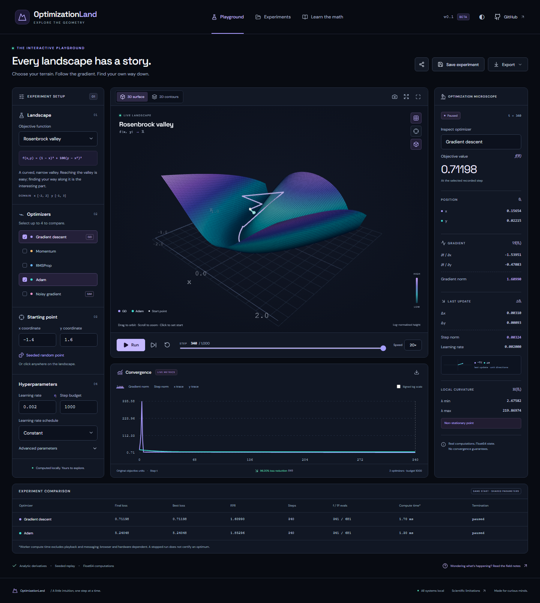

# OptimizationLand

**Explore the Geometry of Optimization**

A static, browser-based scientific playground for seeing how real optimizers move across mathematical landscapes. No account, API key, or server is required.



## Run locally

Requires Node.js 24 and npm.

```sh
npm ci
npm run dev
```

Open `http://127.0.0.1:5173/loss_landscape/`, then **Launch the lab**. Choose a landscape and optimizer, click the surface or enter x/y coordinates, and press **Run**. Single-step, pause, rewind, compare, save, and export from the same workspace. Number fields commit on blur or Enter.

For the production build:

```sh
npm run build
npm run preview
```

Production preview: `http://127.0.0.1:4173/loss_landscape/`.

## What works

- Ten landscapes with analytic gradients/Hessians: quadratic, elliptical quadratic, Rosenbrock, Himmelblau, Rastrigin, Beale, saddle, monkey saddle, double well, noisy quadratic.
- Correct GD, unnormalized heavy-ball momentum, RMSProp, bias-corrected Adam, and explicitly labeled noisy-gradient simulation. No noisy simulation is presented as minibatch SGD.
- Independent state for up to four simultaneous algorithms with a shared initial point and shared hyperparameter configuration.
- Worker-driven run/pause/step/reset, bounded histories, seeded replay, constant/exponential/cosine schedules, optional clipping, and explicit stopping reasons.
- Interactive Three.js surfaces and D3 contours, point picking, orbit/zoom/pan, fit, wireframe/grid, critical markers, and optional negative-gradient field.
- Synchronized loss/gradient/step/parameter plots, numerical inspector, raw optimizer moments, Hessian eigenvalues, and honest comparison counters/timings.
- Ten executable mathematical field notes and formula reference cards.
- Named IndexedDB experiments with restore/resume/duplicate/delete, validated JSON import/export, CSV histories, annotated raster PNG, SVG charts, and configuration-only share links.
- Responsive 2D-first mobile workflow, keyboard numeric controls, high contrast, reduced-motion styles, HTML diagnostics, and chart descriptions.
- Hash routing, local fonts, GitHub Pages base path, CI, and deployment workflow.

This is a working P0 implementation with selected P1 features. It is not the complete research roadmap. Per-algorithm parameter editing, safe custom expressions, basin maps, prediction challenges, and real neural-network training/slices remain planned. See [limitations](docs/limitations.md) for the exact scope. No convergence outcome is a mathematical guarantee.

## Verification

```sh
npm run typecheck
npm run lint
npm run test -- --run
npm run build
npx playwright install --with-deps chromium firefox
npm run test:e2e
```

Scientific tests check known values, finite-difference gradients/Hessians, numerical update fixtures, Adam timestep correction, schedules, seeded replay, resets, evaluation counters, termination, and domain policies. Browser tests exercise real workflows against the built site under `/loss_landscape/`. An automated axe audit checks the core 2D workspace; this supplements, rather than establishes, complete WCAG conformance.

`scripts/browser-review.mjs` captures real desktop/mobile screenshots, checks 3D picking/navigation errors, and exports an actual surface PNG. It expects the production preview on port 4173. Screenshots are located in `docs/images`.

## Deployment status

Deployment target: **https://aashikshahriar.github.io/loss_landscape/**.

Source repository: [Aashikshahriar/loss_landscape](https://github.com/Aashikshahriar/loss_landscape). The included GitHub Actions workflow gates publication on numerical, type, lint, build, and browser checks. See [deployment instructions](docs/deploy.md) and [workflow runs](https://github.com/Aashikshahriar/loss_landscape/actions).

## Technical documentation

- [Architecture and decisions](docs/architecture.md)
- [Mathematics and rendering transforms](docs/mathematics.md)
- [Algorithms, indexing, stopping, and metrics](docs/algorithms.md)
- [Reproducibility and exports](docs/reproducibility.md)
- [Milestone delivery report](docs/milestones.md)
- [Scientific limits and roadmap](docs/limitations.md)
- [Deployment](docs/deploy.md)
- [Portfolio card](docs/portfolio.md)

MIT licensed. Contributions should include independent scientific fixtures for changes to numerical behavior and update the algorithm version when reproducibility contracts change.
