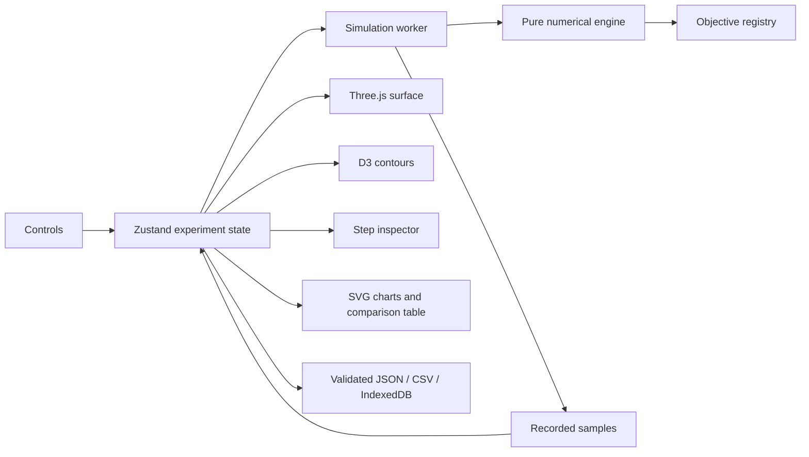

# Architecture decision record — 2026-10-25

## Scope and deployment

This checkout is a static-first, working P0 application with selected P1 features. There is no backend, account requirement, analytics, remote computation, or mandatory external asset host. GitHub Pages is the requested deployment target. Routes use `#/lab`, `#/experiments`, and `#/learn`, so static refreshes resolve to `index.html`. Vite defaults to `/loss_landscape/`; `BASE_PATH` can override it at build time.

## Selected dependencies

Versions actually installed and checked are recorded by `package-lock.json`. Initial validated versions include React/ReactDOM 19.3.1, TypeScript 5.9.3, Vite 8.3.5, Three.js 0.183.2, Fiber 9.8.2, Drei 10.7.9, Zustand 5.0.16, D3 contours 4.0.2, Dexie 4.4.7, Zod 4.6.7, Vitest 5.0.5, Playwright 1.64.1, and ESLint 10.13.0. React 19 is paired with Fiber 9 as documented by its maintainers. Fonts are served from bundled Fontsource assets. No screenshot is an image of fabricated optimizer results.

## Separation of responsibilities

- `src/math/objectives.ts`: ten analytic objectives, gradient/Hessian definitions, domains, recommended starts, caveats, and known critical points.
- `src/math/engine.ts`: pure updates, schedules, seeded noise, stopping rules, objective/gradient evaluation counters. Browser animation never manufactures samples.
- `src/workers/simulation.worker.ts`: independent optimizer states, bounded batch advancement, measured compute time, and snapshot hydration.
- `src/stores/lab.ts`: UI coordination, worker request revision IDs, playback, historical inspection, reset, and restore.
- `src/visualization`: mesh construction, contour paths, rendering transforms, domain filtering, point picking, and GPU resource cleanup.
- `src/components`: controls, playback/viewport, microscope, charts, comparison, number input, and native save dialog.
- `src/features`: landing page, the ten-chapter story page with its interactive widgets (`widgets.tsx`), and the experiment notebook.
- `src/stores/theme.ts`: light/dark/system theme and high-contrast state; colors live as CSS custom properties in `global.css`, with literal values only for canvas/WebGL drawing.
- `src/math/narrative.ts`: the inspector narrator that describes each recorded step in plain language.
- `src/components/Tex.tsx`: KaTeX rendering for all mathematical notation.
- `src/services/experiments.ts`: schemas, IndexedDB, import bounds, portable exports, and compact configuration links.

The 3D renderer and contour module load on demand. A 96×96 cell mesh is memoized per objective; contour sampling uses 80×80 cells. The 3D canvas renders on demand rather than continuously. The simulation performs at most 100 updates per worker message; normal playback requests 1, 5, or 20. Hidden tabs stop requesting work. History is limited to 10,001 samples per run and four runs.

## Numerical and data contracts

JavaScript `number` values use IEEE-754 binary64. Optimizer state uses pairs of those doubles; objective inputs/outputs use `Float64Array`. GPU buffers use float32 only for rendering. Every step is computed in the original objective coordinates and units.

`Config` stores objective ID, initial pair, selected algorithms, hyperparameters, seed, schedule, stopping tolerances, budget, clipping, and domain policy. Hyperparameters are shared across the selected algorithms in this first release; states are independent. This is disclosed in the comparison header and limitations.

`OptimizerState` holds theta, first/velocity and second moments, update index, PRNG state, and actual evaluation counters. `Sample` records theta, objective, analytic gradient, the gradient oracle used for the previous update, gradient/update norms, learning rate, raw moments, measured worker compute time, and status. `Run` retains samples, terminal/active status, counters including rejected updates, and total worker runtime.

`Experiment` has `schemaVersion: 1`, `algorithmVersion: '1.0.0'`, UUID, name, ISO creation timestamp, configuration, and runs. Unsupported schemas are rejected rather than silently migrated. Dexie has an explicit version-1 database schema. Future incompatible formats require a versioned migration and fixtures.

## Main risks and mitigations

1. **Misleading geometry:** the visual height/color transform is labeled, never used by the optimizer, and documented in mathematics.md.
2. **Non-finite updates:** stop explicitly, retain the last finite sample, include rejected calls in counters, and show a warning.
3. **Off-domain steps:** never clamp. Hide off-domain path segments and show an inspector warning; optionally stop on domain exit.
4. **State contamination in racing:** each algorithm owns moments, index, RNG, counters, and termination status.
5. **Stale worker responses:** ignore messages from previous experiment revisions.
6. **Import execution or memory abuse:** never evaluate JS; validate with Zod, cap files at 32 MB, limit algorithms/history, and reject non-finite values. Imported numerical content is not independently certified.
7. **WebGL failure:** offer a 2D fallback and keep essential controls and numerical inspection in HTML.
8. **Unverified deployment:** prepare Actions but do not claim the public URL works until authenticated deployment and a live check succeed.

## Verification sources

- [Fiber installation and React compatibility](https://r3f.docs.pmnd.rs/getting-started/installation)
- [Vite static deployment and base paths](https://vite.dev/guide/static-deploy.html)
- [GitHub custom Pages workflows](https://docs.github.com/en/pages/getting-started-with-github-pages/using-custom-workflows-with-github-pages)
- [Checkout maintained version](https://github.com/actions/checkout)
- [Setup Node maintained version](https://github.com/actions/setup-node)
